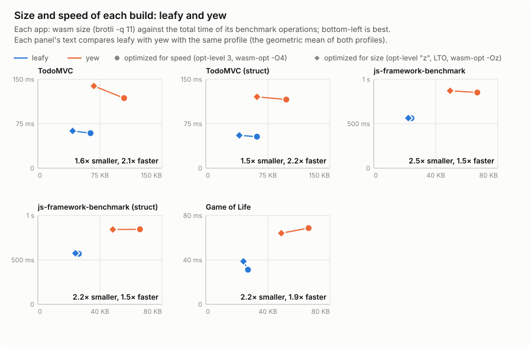
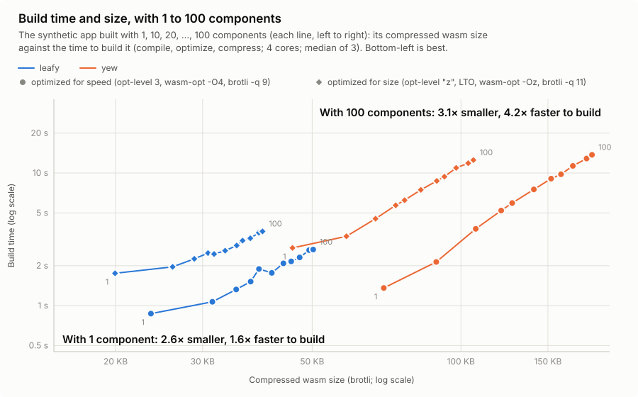
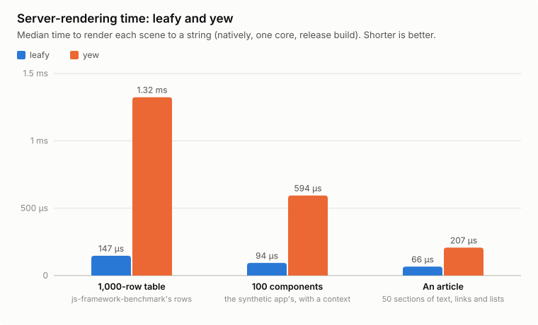

# 🍃 leafy

[](https://crates.io/crates/leafy)
[](https://docs.rs/leafy)
[](https://github.com/finnbear/leafy/actions/workflows/ci.yml)

A Rust web UI library that implements a subset of [yew](https://yew.rs)
without a virtual DOM, producing much smaller (and often faster)
WebAssembly binaries.

It keeps yew's programming model and API, so existing yew code compiles
almost unchanged, but compiles markup into static templates and compact
patching code. yew's documentation applies, except for the
[differences](#-differences-from-yew) below.

## 🚀 Getting started

```toml
[dependencies]
leafy = "0.1"
```

```rust
use leafy::prelude::*;

#[function_component]
fn App() -> Html {
    let count = use_state(|| 0);
    let onclick = {
        let count = count.clone();
        Callback::from(move |_: MouseEvent| count.set(*count + 1))
    };
    html! { <button {onclick}>{"Clicked "}{*count}{" times"}</button> }
}

fn main() {
    leafy::Renderer::<App>::new().render();
}
```

Requires Rust 1.88 or later. Build it like any yew app, e.g. with
[trunk](https://trunk-rs.github.io/trunk/) (see `examples/counter`).

## 🏎️ Benchmarks

The same apps built against yew 0.23 and against leafy, from identical
source ([`bench/`](bench/README.md) reproduces them).







## 🔁 Drop-in replacement for yew

Depend on leafy (and leafy_router) under yew's names, and code written for
yew (`use yew::prelude::*`) compiles against leafy:

```toml
[dependencies]
yew = { package = "leafy", version = "0.1" }
yew-router = { package = "leafy_router", version = "0.1" }
```

The macros find the crate under whatever name it is imported. A dependency
that depends on yew needs a version for leafy.

## 🔀 Differences from yew

### Behavior

- `Html` is leafy's own enum (`Empty`, `Text`, `Tpl`, `List`, `Comp`, `Raw`,
  `VRef`); code that matches on yew's `VNode` variants needs adjusting.
  `virtual_dom::VList` is a builder that converts to and from `Html`.
- Child components render depth-first, immediately when their parent is
  patched; yew renders them later from its queue. Anything order-dependent
  across siblings can differ.
- Event listeners are attached to their elements, not delegated from the
  root.
- `Classes` keeps duplicates; boolean attributes are rendered as
  `disabled=""`.
- `selected` (on `<option>`) and `muted` (on `<video>`/`<audio>`), when not
  literals, are set as properties (like `value` and `checked`), so they
  apply even after the user changed them.
- A repeated attribute, or a known event name with capitals (`onSubmit`),
  is a compile-time warning.
- A message a struct component sends itself in `create` is handled before
  its first `view`.

### Additions

- `css!("color: red; &:hover { color: blue; }")`: a class for a stylesheet
  written at compile time (stylist's `css!` syntax, but only a literal: no
  interpolation). It's a `CssClass`, usable as or in `Classes`, and adds a
  `<style>` to `<head>` the first time it's used.
- `global_css!("body { margin: 0; }")`: a page-wide stylesheet written at
  compile time, added to `<head>` by its `register()`.
- `ServerRenderer::render_with_css()` returns the stylesheets the output
  uses (of either macro), wherever its `Html` was built, and
  `render_page()` renders a whole page (`<!DOCTYPE html>` and an `<html>`)
  with them at the end of its `<head>`.
- `use_context_selector(|ctx: &T| ctx.part.clone())`: re-renders only when
  the selected part of a context changes. Useful for a context that changes
  often, read by components that need only a stable part of it.

### Removals

- Suspense.
- Hydration.
- Portals.
- Dynamic tag names (`<@{..}>`).
- Agents.
- Async server rendering: one `ServerRenderer`, whose `render()` returns the
  `String` (no `LocalServerRenderer`, no `hydratable`).

### Router (`leafy_router`, a port of yew-router 0.20)

- `#[derive(Routable)]` matches routes with generated code (one shared
  matcher and a table of the routes), not a `route-recognizer` router built
  at runtime; the route chosen is the same.
- `Routable::routes()` returns `Self::Routes`, an iterator (no allocation;
  an impl wrapping other `Routable`s can chain theirs), not a `Vec`.

## ⚙️ How it works

There's no virtual DOM. `html!` turns each element tree into:

- a static **template**: an HTML string (parsed by the browser once, into a
  `<template>`, and deep-cloned for each instance) and a tiny **walk** program
  that finds the nodes the dynamic parts act on, and
- a list of **holes**: the dynamic attribute values, listeners, refs and
  children, which are all that is built per render.

```rust
html! { <div class="card"><b>{"Name: "}</b>{name}<button {onclick}/></div> }
// expands to (simplified):
{
    static T: Tpl = tpl(r#"<div class="card"><b>Name: </b><button></button></div>"#, "fRfnceclick;");
    let f = begin();
    child(name);                // inserted before the <button>
    on::<MouseEvent>(onclick);  // a listener on the <button>
    end(&T, f)
}
// walk: f(irst child) R(oot) f n(ext sibling) c(hild hole before here)
//       e(vent)click;
```

### Speed

- Static text, attributes and structure are never rebuilt or compared.
  Patching compares each hole with the previous render's and touches the DOM
  only for those that changed, so its cost follows the dynamic parts, not
  the size of the markup.
- Creating an element tree is one native clone and a short walk, rather than
  a `createElement`/`setAttribute`/`appendChild` call (each a call out of
  wasm, often with a string to decode) for every node.
- Listeners are attached once per element; changing a callback only swaps a
  pointer.
- Keyed lists move only the items outside the longest run that kept its
  order.
- Components need no wrapper DOM node and render depth-first as their parent
  is patched (no queue), and not at all when their properties are equal.
  Rendering is batched in a microtask (as yew), parents before children;
  effects (and `rendered`) run children first, as in yew.
- Server rendering copies each template's HTML and splices in the holes at
  offsets the macro computed, rather than formatting every node.

### Size

- Static markup is in strings, which compress well, both individually and
  collectively.
- No `dyn Fn`: a `Callback` is a refcounted box with one `call` function
  pointer (and, only if needed, a `drop` one), so a closure type costs only
  its body.
- Holes go onto one shared stack, so a hole costs one call with one
  argument.
- Generic code in the runtime is a thin wrapper around non-generic,
  out-of-line code, so a component or hook call site is little more than a
  call.
- A component is a function plus a 3-entry vtable; hooks are slots in a
  `Vec`.
- DOM access goes through a few dozen hand-declared `wasm_bindgen` imports,
  without exception handling.
- The macros fold literal text and attributes into the template.

### Trade-offs

- The DOM has extra empty text and comment nodes, anchoring dynamic content
  (and a component in a list).
- Content the HTML parser would restructure (a `<div>` in a `<p>`, a `<tr>`
  directly in a `<table>`) is split out of the template by the macro, into
  a template of its own, with a compile-time warning: a browser would
  restructure it in a server-rendered page.

## 🔬 How it was made

Written by Claude Opus 5.5 from roughly 75 prompts with moderate guidance.
It was checked against yew's behavior with browser tests (`tests_app/run.sh`,
in headless Chromium), native tests (`cargo test --workspace`), regression
tests for bugs from yew's issue tracker, a differential test of the router
against `route-recognizer`, and by porting a
[large yew app](https://voxmaxa.com).

## ⚖️ License

Licensed under either of

- Apache License, Version 2.0 ([LICENSE-APACHE](LICENSE-APACHE) or
  <http://www.apache.org/licenses/LICENSE-2.0>)
- MIT license ([LICENSE-MIT](LICENSE-MIT) or
  <http://opensource.org/licenses/MIT>)

at your option.

`leafy_router` and `leafy_router_macro`, ported from yew-router, keep its
licenses (the same).

## 🤝 Contribution

Unless you explicitly state otherwise, any contribution intentionally
submitted for inclusion in the work by you, as defined in the Apache-2.0
license, shall be dual licensed as above, without any additional terms or
conditions.
